# Universal Blinder: user guide

Version 3.1.0 · Illustrated edition · November 13, 2026

Universal Blinder makes **blinded copies of pharmacokinetic (PK) datasets** (SDTM and ADaM, e.g. PC, EX, ADSL, ADNCA/ADPC, ADPP) that you can send to a CRO, a vendor, another team or a review tool. The copies keep their structure, so NCA and review programs still run on them. Subjects, sites, treatment and analyte names, dates, covariates and concentrations are disguised in a consistent way across all datasets of a study. A private **key**, which never leaves your computer, maps every finding back to the original records.

Everything is done in the **app**. You do not need to write or edit code.

## Contents
1. [Install and start](#install-and-start)
2. [The app at a glance](#the-app-at-a-glance)
3. [The tabs, one by one](#the-tabs-one-by-one)
4. [The workflow at a glance](#the-workflow-at-a-glance)
5. [Workflow 1: PC has its results](#workflow-1-pc-has-its-results)
6. [Workflow 2: PC without results, results in a separate file](#workflow-2-pc-without-results-results-in-a-separate-file)
7. [Workflow 3: the results can't be put into PC: release the lab file blinded](#workflow-3-the-results-cant-be-put-into-pc-release-the-lab-file-blinded)
8. [Which datasets can be blinded](#which-datasets-can-be-blinded)
9. [The codebook](#the-codebook-every-replaced-value-and-its-code)
10. [The study folder: what you may share, and what never](#the-study-folder-what-you-may-share-and-what-never)
11. [What the run does](#what-the-run-does)
12. [Study settings](#study-settings)
13. [When QC reports WARN or FAIL](#when-qc-reports-warn-or-fail)
14. [Reviewing the blinded data and getting the original records back](#reviewing-the-blinded-data-and-getting-the-original-records-back)
15. [The AI assistant](#the-ai-assistant)
16. [Start a study again from scratch](#start-a-study-again-from-scratch)
17. [New data for the same study](#new-data-for-the-same-study)
18. [Troubleshooting](#troubleshooting)

---

## Install and start

1. **R 4.1 or later** (and RStudio, if you like).
2. **Install the package once.** In R:
   ```r
   install.packages(c("haven", "jsonlite", "shiny", "bslib", "shinyFiles", "DT", "httr2", "readxl", "openxlsx", "commonmark", "remotes"))
   remotes::install_github("irubets/Universal_blinder_R")
   ```
   (or, from a downloaded copy: `install.packages("C:/tools/Universal_blinder_R", repos = NULL, type = "source")`).
3. **Start the app:** in R, `universalblinder::run_app()`, or double-click `run_app.bat` in the package folder. The app opens in your web browser at `http://127.0.0.1:3838` (always the same address, so you can bookmark it; if that port is taken, for example because the app is already open in another R session, a free port is used and R shows the address). It runs on your computer only. `run_app.bat` uses the newest R in `C:\Program Files\R`, so install the package (step 2) in that R; keep its black window open while you use the app, and close it to stop the app.

## The app at a glance

| Tab | What you do there |
|---|---|
| **Workflow** | See which steps are done for the selected study, and jump to the next one |
| **Study** | Choose the study folder (folder tree, or paste its path, with or without quotes); create its `UB_<StudyNumber>` folder; copy the datasets to blind into `input` |
| **Prepare PC** | Workflow 2 only: put the lab's results into PC |
| **Study settings** | Settings a study rarely needs (aliases, variables to leave out, QC waivers, ...) |
| **Codebook review** | Check the codes that replace drug, analyte, arm and cohort names |
| **Blind & QC** | Pre-flight check, run the blinding, read the QC result |
| **Retrieve** | Get the original records behind a reviewer's findings |
| **AI assistant** | Ask Claude or a local model about the workflow, QC findings, settings, the codebook, or the blinded data |
| **Setup / About** | Installation check |

Colours mean the same in every table and report: **red** = must fix, **amber** = needs your decision or attention, no colour = OK. Each tab is explained, with a screenshot and every control, in [The tabs, one by one](#the-tabs-one-by-one).

## The tabs, one by one

This part explains every tab: **what it is for**, **when you need it**, and **what each button, box and table does**. You do not have to read it in order. If you are new, read *Before you start* and *Your first session in six clicks*, then use the tab sections as a reference while you work.

All screenshots in this guide were captured from the running app using the bundled synthetic study and a separate mock lab-results study. Drug names such as Fictinib and Synthazole, subject identifiers, results and findings are invented. No original study input data or private key was used or loaded to create these screenshots. No AI requests were sent while preparing this guide. Screenshots show different stages of the demonstration; they are navigation examples, not evidence that a real study is safe to release. Scroll down in the app when a control is below the visible part of a screenshot. In the standalone HTML guide, click a screenshot (or focus it and press Enter) to inspect it at full size. Scroll within the enlarged image and use **Close image** or **Escape** to return. The PNG files are also available in `inst/app/www/docs/screenshots`.

### Before you start: how the screen is built

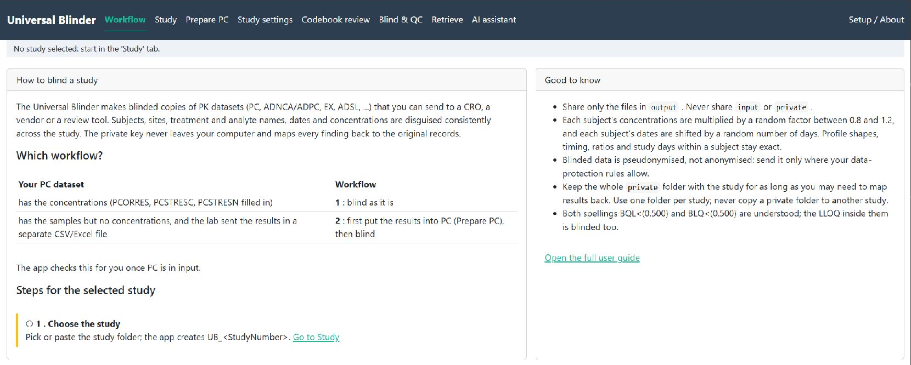

*Figure 1. Start here: the tab bar, study banner and Workflow page before choosing a study.*

1. **Tab bar** (top): one tab per task. **Setup / About** sits at the far right. You can click any tab at any time; nothing is lost when you switch.
2. **Study bar** (directly under the tab bar): shows the **study folder** the app is working on, and the warning that `input\` and `private\` hold real data and must never be shared. Before you choose a study it says *No study selected: start in the 'Study' tab*.
3. **Tab content** (below): the cards, tables and buttons of the selected tab.

Conventions used everywhere:

| What you see | What it means |
|---|---|
| **Green button** | The main action of the screen (run, copy, retrieve, apply). |
| **Blue button** | A step that prepares something (browse, run the pre-flight, save). |
| **Grey outlined button** | A side action (rescan, discard, open a folder). |
| **Red button** | Destructive: it resets or replaces something. It always asks first and keeps a backup. |
| **Table row highlighted in blue** | The row is *selected*. Click a row to select it; click it again to un-select. There are no tick boxes. |
| **Double-click a table cell** | Edits the cell. Press **Enter** to accept it; most tables then need a *Save* button. |
| **Red / amber / no colour** | Red = must fix. Amber = needs your decision. No colour = fine. |
| **Coloured box with a link** (for example *Codebook review →*) | The app tells you what to do next; click the link to go there. |

### Your first session in six clicks

1. **Study** tab → *Browse folders...* → pick the study folder → *Create the folder*.
2. **Study** tab → select the datasets → *Copy selected files to input*.
3. **Blind & QC** → *1. Pre-flight* → *Run pre-flight* → accept what suits you with *Apply suggestions*.
4. **Blind & QC** → *2. Run blinding* → *Run blinding*. The first run stops once, on purpose.
5. **Codebook review** → answer the amber and red rows → type your name → *I have reviewed the codebook*. Then run the blinding again.
6. **Blind & QC** → *3. QC result* → read it. Share only the files in `output`.

The **Workflow** tab shows exactly where you are in these steps for the selected study.

### Workflow tab: where am I, and what is next?

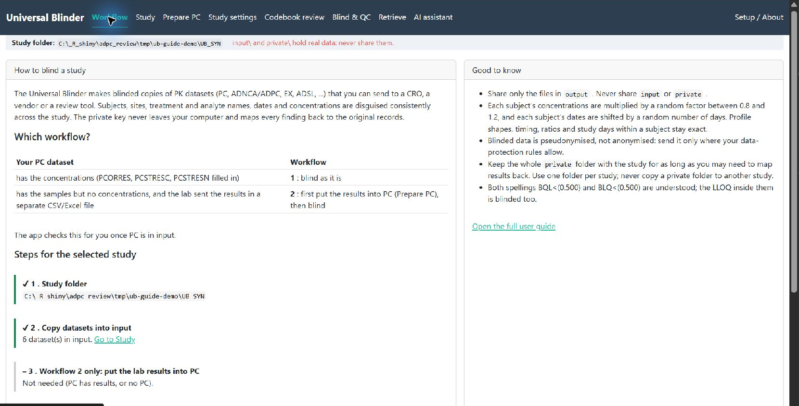

*Figure 2. A selected synthetic study. Completed steps have green markers; more steps continue below the screen.*

**Purpose.** A to-do list for the selected study. It tells you which step is done, which is waiting for you, and which has failed, and it jumps you to the right tab.

**When you need it.** First, to see the overall picture; later, whenever you come back to a study and do not remember where you stopped.

| Control | What it does |
|---|---|
| **How to blind a study** card | Short description of the tool and a table that tells you whether your PC dataset needs Workflow 1 (PC has the concentrations) or Workflow 2 (PC has no concentrations, the lab sent them separately). The app checks this for you once PC is in `input`. |
| **Steps for the selected study** | Seven steps. A **green bar and tick** = done, an **amber bar and empty circle** = still to do, a **red bar and cross** = needs attention (for example a failed QC), a **grey bar and dash** = not needed for this study. |
| **Go to ... links** (end of each step) | Open the tab where that step is done (Study, Prepare PC, Blind & QC, Codebook review, Retrieve). |
| **Good to know** card | The rules you must remember: share only `output`; keep the whole `private` folder; blinded data is pseudonymised, not anonymised. |
| **Open the full user guide** | Shows this guide inside the app. |

### Study tab: choose the study and put the datasets into `input`

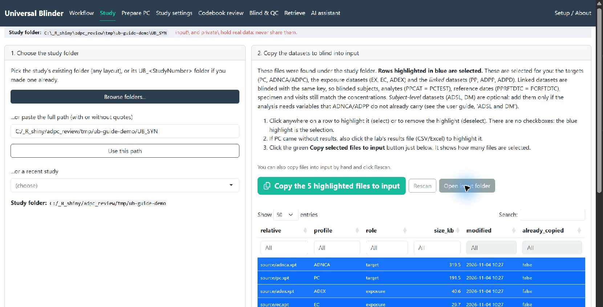

*Figure 3. The separate mock study and its source dataset selections. Blue rows are selected; scroll down for the remaining files and Status card.*

**Purpose.** Tell the app which study you work on and which datasets to blind. The app never changes your original files: it **copies** the chosen datasets into its own `input` folder.

**When you need it.** At the start of every study, and again when new data arrive (see [New data for the same study](#new-data-for-the-same-study)).

**Card 1. Choose the study folder**

| Control | What it does |
|---|---|
| **Browse folders...** (blue) | Opens a folder tree. Pick the study's folder; the layout inside it does not matter. |
| **...or paste the full path** + **Use this path** | The same, by typing or pasting a path. Quotes around the path are fine. |
| **...or a recent study** | A list of studies you used before. Choosing one opens it. |
| *Study folder:* line | Confirms which folder was chosen. |
| **Create the Universal Blinder folder** box (appears once a folder is chosen and has no `UB_` folder yet) | **Study number** is read from STUDYID; you can change it. The grey block shows the folders that will be created. **Create the folder** (green) makes `UB_<StudyNumber>` with `input`, `output`, `private` and the settings file. An existing `UB_` folder is opened, never overwritten. |

**Card 2. Copy the datasets to blind into input**

| Control | What it does |
|---|---|
| **Dataset table** | Every dataset the app found under the study folder, with the profile it recognises (PC, ADNCA, EX, ...). The targets, exposure datasets and linked datasets are already selected (blue). Click a row to select or un-select it. Include at least one exposure dataset (EX, EC or ADEX). |
| **Copy selected files to input** (green) | Copies the selected files into `input`. The button shows how many rows are selected. |
| **Rescan** | Looks again for datasets, for example after you added files to the study folder. |
| **Open input folder** | Opens `input` in Windows Explorer. Use it to drop in a file by hand, such as the lab's results file for Workflow 2. |

**Card 3. Status**

| Control | What it does |
|---|---|
| **PC notice** | A green, amber or blue box about PC. If PC has no concentrations it asks whether the lab sent a results file, with a **Recheck** button (after you copied that file into `input`) and **Go to Prepare PC**. |
| **Status list** | The study folder, what is in `input`, and the status of the key, the codebook and the last QC. |
| **Saved settings box** and **Reset settings to defaults** (red) | Lists the choices you saved that differ from the defaults. The reset asks first and keeps a backup. See [Start a study again from scratch](#start-a-study-again-from-scratch). |

### Prepare PC tab: only when PC has no concentrations (Workflow 2 and 3)

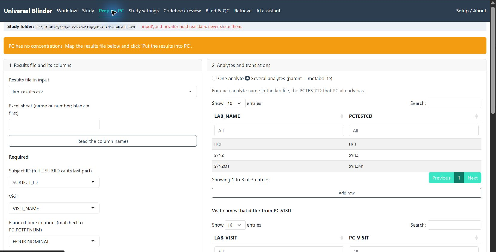

*Figure 4. Mock PC without concentrations, with lab_results.csv selected and three analytes mapped. This tab is skipped when PC already has results.*

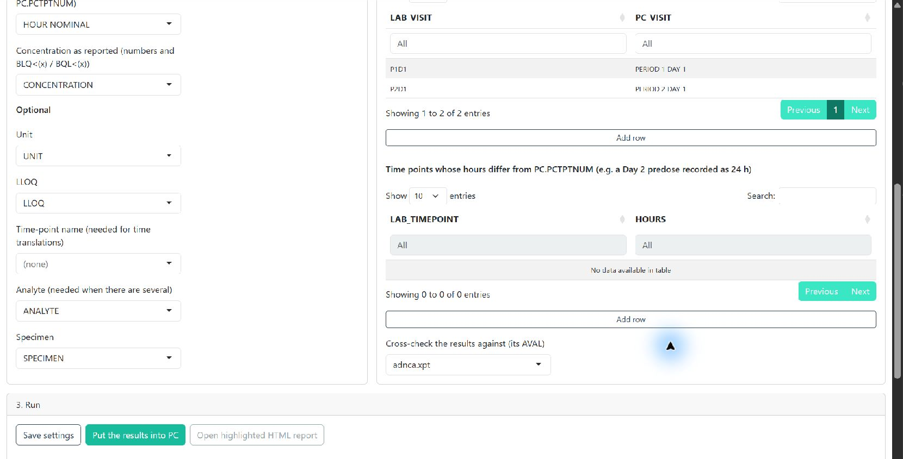

*Figure 4a. The lower mappings: visit translations, optional result fields, ADNCA cross-check and the Run card.*

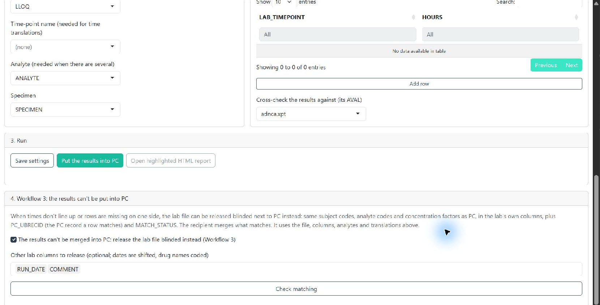

*Figure 4b. Workflow 3 controls at the bottom of Prepare PC. Enable separate blinded lab release only after reviewing matching and the selected columns.*

**Purpose.** Some PC datasets contain the samples but not the results; the lab sends the results in a separate CSV or Excel file. This tab puts those results into PC before blinding (Workflow 2), or, when they cannot be matched, prepares the lab file to be released blinded next to PC (Workflow 3).

**When you need it.** Only if the top of the tab (or the Workflow and Study tabs) says PC has no results. Otherwise skip it. Step-by-step: [Workflow 2](#workflow-2-pc-without-results-results-in-a-separate-file) and [Workflow 3](#workflow-3-the-results-cant-be-put-into-pc-release-the-lab-file-blinded).

| Card and control | What it does |
|---|---|
| **1. Results file and its columns** | |
| *Results file in input* | The lab file you copied into `input` (CSV or Excel). |
| *Excel sheet* | Sheet name or number; blank = the first sheet. |
| **Read the column names** | Reads the file's headers so the pick lists below can be filled. |
| *Subject, Visit, Planned time, Concentration* (required) and *Unit, LLOQ, Time-point name, Analyte, Specimen* (optional) | Tell the app which column of the lab file holds what. |
| **2. Analytes and translations** | |
| *One analyte* / *Several analytes (parent + metabolite)* (radio buttons) | One analyte in the file: type the PCTESTCD and PCTEST that PC already uses. Several: fill the table with the PCTESTCD for each analyte name in the lab file. |
| *Visit names that differ from PC.VISIT* and *Time points whose hours differ from PC.PCTPTNUM* tables | Translate the lab's spelling or hours into PC's (for example a Day 2 predose recorded as 24 h). **Add row** adds a line; double-click a cell to edit. |
| *Cross-check the results against (its AVAL)* | Optionally compares the merged results with an existing ADNCA/ADPC. |
| **3. Run** | |
| **Save settings** | Stores the choices above without running. |
| **Put the results into PC** (green) | Merges the results into PC. The tables below show what matched and what did not. |
| **Open highlighted HTML report** | Opens the matching report with problems highlighted. |
| **4. Workflow 3** | |
| *The results can't be merged into PC: release the lab file blinded instead* (tick box) | Switches to Workflow 3. |
| *Other lab columns to release* | Extra columns of the lab file to keep (dates are shifted, drug names coded). |
| **Check matching** | A dry run: shows how many lab rows match a PC record, without writing anything. |

### Study settings tab: the rarely needed options

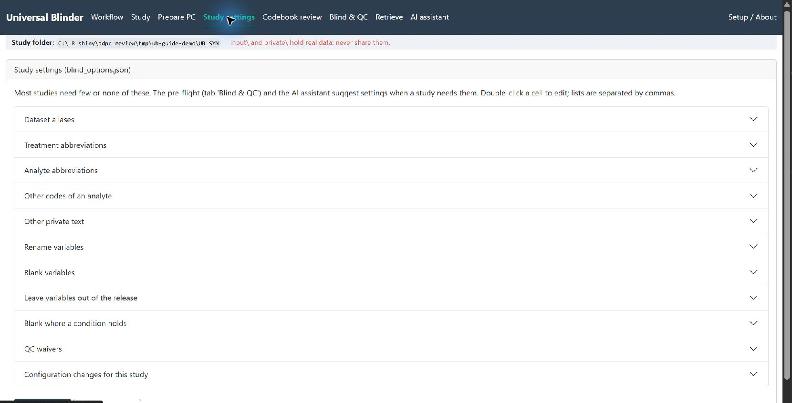

*Figure 5. Expand the relevant settings section, edit its table and save the changes at the bottom.*

**Purpose.** All the study-specific choices, saved in `blind_options.json` next to `input`. Most studies need few or none.

**When you need it.** When the pre-flight, the QC result or the AI assistant tells you to change a setting that cannot be applied with one click.

The tab is a stack of **collapsible sections**. Click a section's title to open it.

| Section | Use it to |
|---|---|
| **Dataset aliases** | Tell the app that a file with an unusual name has the structure of a known one (for example ADCONC is an ADNCA). |
| **Treatment abbreviations** / **Analyte abbreviations** / **Other codes of an analyte** | Teach the app short names or extra codes of a drug or analyte so they are replaced in free text too. |
| **Other private text** | Any other text that identifies the study and must be replaced everywhere. |
| **Rename variables** | Rename variables whose **name** contains a drug fragment. |
| **Blank variables** | Empty extra variables in the released data. |
| **Leave variables out of the release** | Remove variables from `output` (they come back on retrieval), for example RACE. |
| **Blank where a condition holds** | Empty variables on rows where an original variable has certain values (default: planned doses in mg/m²). |
| **QC waivers** | Accept a QC finding after a documented review: the reason and the reviewer's name are recorded. |
| **Configuration changes for this study** | Common cases as switches, and a JSON box for anything else (checked when you save). |

In every table: **Add row** adds a line, click rows and **Delete selected rows** removes them, double-click a cell to edit it. Nothing is stored until you click **Save settings** (blue); **Discard changes** returns to the saved version. Every save keeps a backup.

### Codebook review tab: check what replaces what

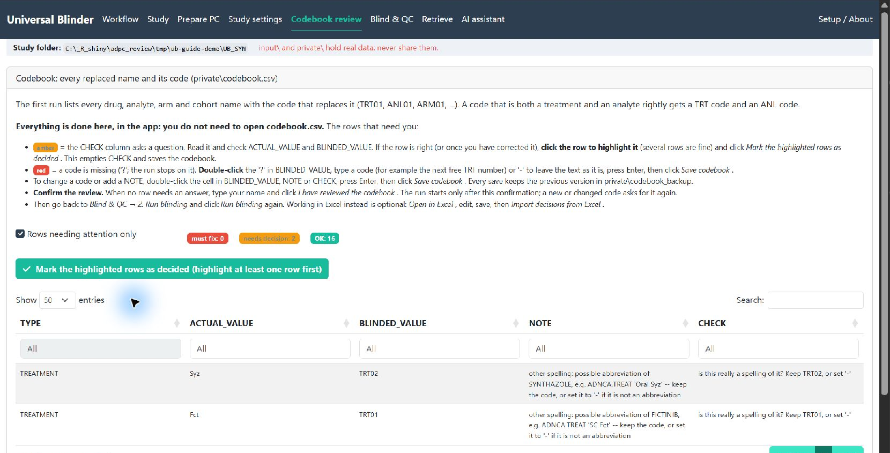

*Figure 6. Two synthetic treatment abbreviations need a decision. The ACTUAL_VALUE column is private in a real study; only invented values are shown here.*

**Purpose.** The codebook lists every drug, analyte, arm and cohort name and the code that replaces it (TRT01, ANL01, ARM01, ...). You confirm that the replacements are right before anything is released.

**When you need it.** After the first *Run blinding*, which stops once because the codebook is new. You work **entirely in the app**; `codebook.csv` never has to be opened. Details: [Step 4](#step-4-codebook-review-answer-the-rows-and-confirm-the-review).

| Control | What it does |
|---|---|
| **Rows needing attention only** (tick box) | Shows only the rows with a question; un-tick it to see the whole codebook. |
| **Counts** (next to the tick box) | How many rows are amber (decide) and red (answer). |
| **Amber row** | The CHECK column asks a question. Read it, check ACTUAL_VALUE and BLINDED_VALUE, then select the row. |
| **Mark the highlighted rows as decided** (green) | Empties CHECK for the selected rows and saves. The button shows how many rows are selected. |
| **Red row** | A code is missing (`?`). Double-click the `?` in BLINDED_VALUE, type a code (or `-` to leave the text as it is) and press Enter. |
| **Save codebook** (blue) | Saves your edits; the previous version is kept in `private\codebook_backup`. |
| **Discard changes** | Goes back to the saved codebook. |
| **Open highlighted HTML** / **Open in Excel** / **Import decisions from Excel** | Optional: review in a coloured web page or in Excel, then import your decisions back. |
| **Ask the local AI model** | Asks a local model for codebook suggestions. Real names never go to Claude. |
| **Your name** and **I have reviewed the codebook** | Shown when no row needs an answer. Type your name and click the button; the run is released only after this confirmation. |
| **Codebook review done** (green box with a link) | Appears when the review is confirmed; the link takes you back to *Run blinding*. |

### Blind & QC tab: check, run and read the result

This tab has three sub-tabs, in the order you use them.

**1. Pre-flight**

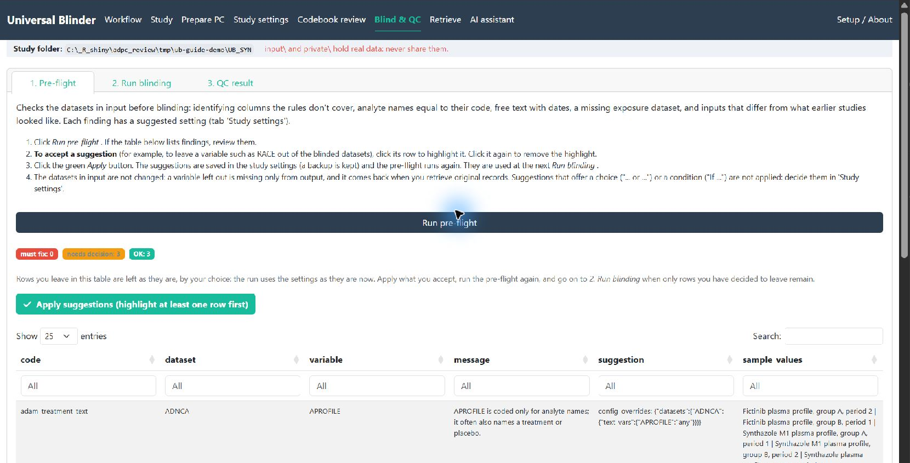

*Figure 7. Pre-flight findings from the mock study. Select accepted suggestions and apply them; read conditional suggestions before deciding.*

**Purpose.** A safety check of the datasets in `input` *before* blinding: identifying variables the rules do not cover, analyte names equal to their code, free text with dates, a missing exposure dataset, and so on. It changes nothing by itself.

| Control | What it does |
|---|---|
| **Run pre-flight** (blue) | Runs the check and lists what it found. |
| **Findings table** | One row per finding with a suggested setting. Red rows are the ones QC is likely to fail on. Click a row to select it. |
| **Apply suggestions** (green) | Saves the selected suggestions into the study settings (with a backup) and runs the pre-flight again. The files in `input` never change. Rows that offer a choice ("... or ...") or a condition ("If ...") are not applied: decide them in *Study settings*. |
| **Explain these with the AI assistant** | Opens the AI assistant with these findings. |
| **Saved settings** box (below the table) | The choices you already made, with *Reset settings to defaults*. |
| *Nothing left to decide* | The table is empty: you are done. Rows you leave in the table stay as they are, by your choice. |

**2. Run blinding**

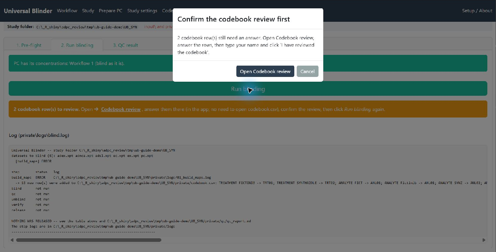

*Figure 8. The codebook gate prevents another run until outstanding rows are answered and the review is confirmed. This checkpoint is expected.*

**Purpose.** The button that blinds the data, checks it and, when QC allows, releases it into `output`.

| Control | What it does |
|---|---|
| **Run blinding** (large green button) | Blinds, runs QC and releases. |
| **Blue box** (before the first run) | Reminds you that the first run stops once for the codebook review. |
| **Amber box with *Codebook review →*** | *N codebook row(s) to review*; the link opens that tab. |
| **Result box** | Green when released. A red box says *NOTHING WAS RELEASED* and lists the failed checks, with the buttons **Open 1. Pre-flight**, **Open 3. QC result** and **Ask the AI why**. The log is never sent to the AI. |
| **Log** (grey panel) | The run's log, `private\logs\blind.log`. |

If PC has no results, a window offers **Go to Prepare PC**, **Release the lab file blinded (Workflow 3)** or **Continue anyway**.

**3. QC result**

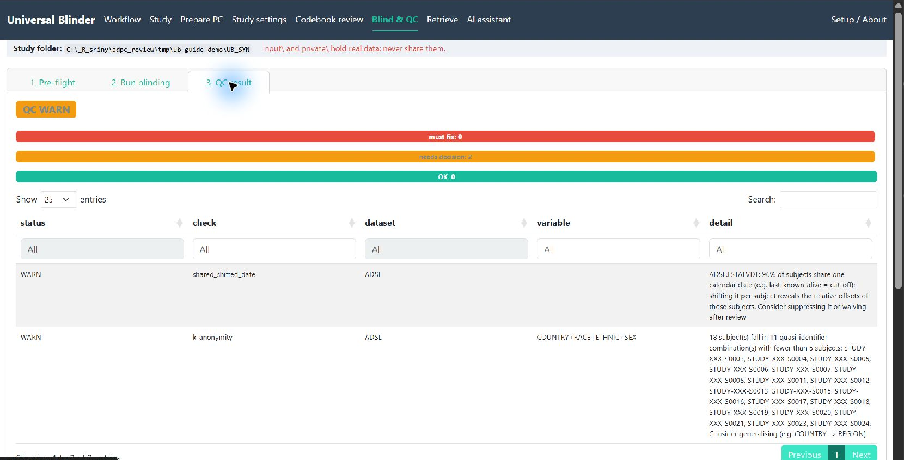

*Figure 9. The actual demonstration result is WARN, with two ADSL disclosure warnings and no FAIL findings. Review warnings before sharing; WARN is not automatic approval.*

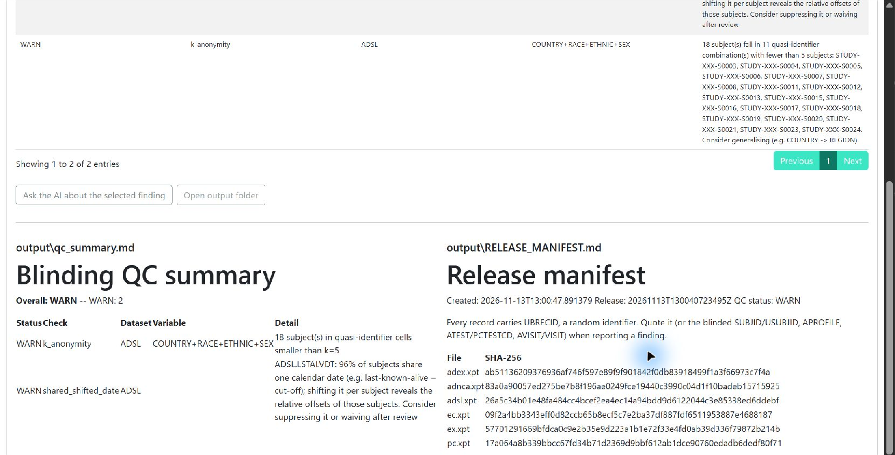

*Figure 9a. Scroll below the findings for the QC summary and release manifest, including the released files and their SHA-256 hashes.*

**Purpose.** Tells you whether the blinded data may be shared.

| Control | What it does |
|---|---|
| **Badge** | **PASS** (nothing found), **WARN** (released; read each warning), or **FAIL** (nothing released). |
| **Counts** | Number of findings by severity. |
| **Findings table** | Dataset, check, variable and detail of each finding. |
| **Ask the AI about the selected finding** | Sends the selected finding, with real values masked, to the AI assistant. |
| **Open output folder** | Opens `output`, the only folder you may share. |
| **qc_summary.md** and **RELEASE_MANIFEST.md** | The two documents that go with the release; they are shown here as well as in `output`. |

### Retrieve tab: from a reviewer's finding back to the original record

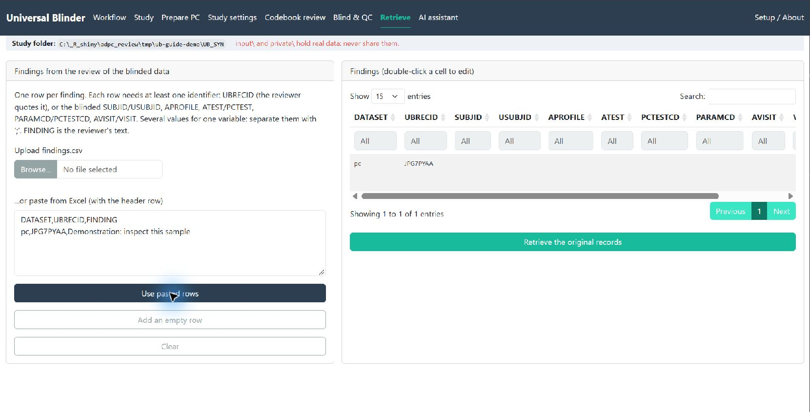

*Figure 10. A mock finding pasted with its header and loaded into the findings table. UBRECID comes from the synthetic blinded PC output; use identifiers from your own release.*

**Purpose.** A reviewer sees only blinded data. When they report a finding, this tab finds the **original** records behind it, using the private key.

**When you need it.** After the recipient has reviewed the blinded data and sent you findings. Details: [Reviewing the blinded data and getting the original records back](#reviewing-the-blinded-data-and-getting-the-original-records-back).

| Control | What it does |
|---|---|
| **Upload findings.csv** | Loads a findings file from the reviewer. |
| **...or paste from Excel** + **Use pasted rows** | Paste the rows with their header line, then click the button. |
| **Add an empty row** / **Clear** | Type a finding by hand / start again. |
| **Findings table** | One row per finding (UBRECID or SUBJID, APROFILE, ATEST, AVISIT, ... and the reviewer's FINDING text). Double-click a cell to edit. |
| **Retrieve the original records** (green) | Shows the original records in the app and writes them to `private\retrieved`. |

### AI assistant tab: optional help from Claude or a local model

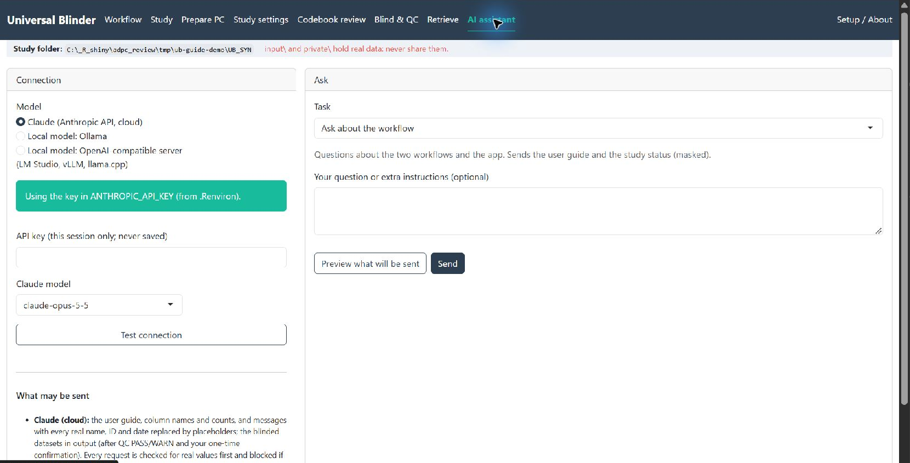

*Figure 11. Optional connection and question controls. No API key is displayed and no request was submitted for this guide; model choices depend on your installation.*

**Purpose.** Explains findings, suggests settings and codebook decisions, and reviews the blinded data. It is optional and never changes anything until you apply a suggestion. What may be sent where is described in [The AI assistant](#the-ai-assistant).

| Control | What it does |
|---|---|
| **Model** (radio buttons) | Claude (cloud), a local Ollama model, or a local OpenAI-compatible server. |
| **API key** | For Claude: used for this session only and never saved. Alternatively set `ANTHROPIC_API_KEY` in `.Renviron`. |
| **Claude model** / **Server address**, **List installed models**, **Local model** | Choose the model. |
| **Test connection** | Checks that the model answers. |
| **What may be sent** | The rules the app enforces. A request containing a real value is blocked before it leaves your computer. |
| **Task** | Ask about the workflow; triage pre-flight / QC; suggest codebook decisions; suggest settings; review the blinded output; check unexpected input. |
| **Your question** | Optional extra instructions. |
| **Preview what will be sent** | Shows the exact text first. |
| **Send** (blue) | Sends it. The answer appears below. |
| **Suggestions** table and **Apply** (green) | Select the rows you agree with and apply them to the study settings (with a backup). Rows marked *explanation only* are never applied. |

### Setup / About tab: is everything installed?

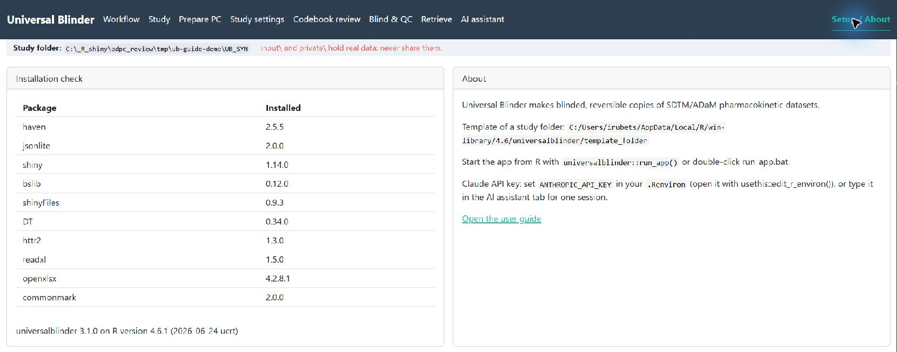

*Figure 12. Installation checks for the documented app. Installed dependency versions and local paths can differ on your computer.*

**Purpose.** A quick installation check and the pointers you need at set-up time.

| Control | What it does |
|---|---|
| **Installation check** | Lists each required R package and its version; **MISSING** means install it (see [Install and start](#install-and-start)). Also shows the Universal Blinder and R versions. |
| **About** | The location of the study-folder template, how to start the app, and how to set `ANTHROPIC_API_KEY`. |
| **Open the user guide** | Shows this guide in the app. |

---

## The workflow at a glance

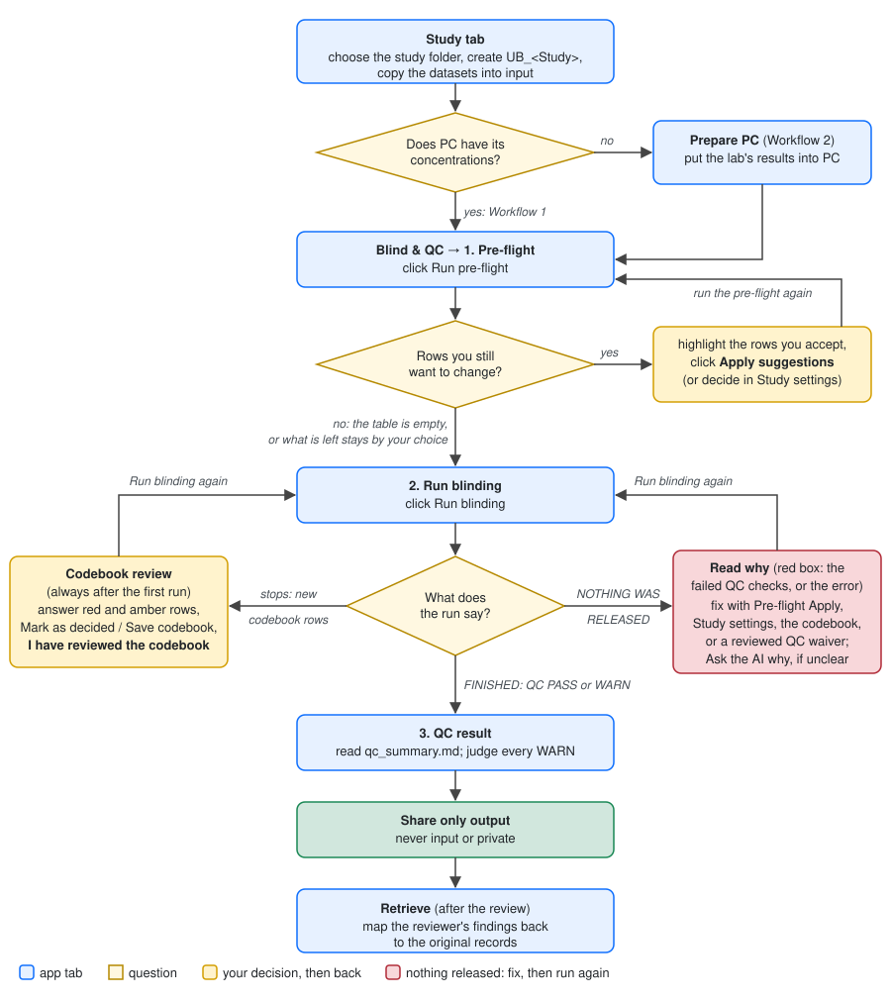

**Which workflow?** Look at PC (the app checks it for you once PC is in `input`):

| Your PC dataset | Workflow |
|---|---|
| **has the concentrations** (PCORRES, PCSTRESC, PCSTRESN filled in), or there is no PC | **Workflow 1**: blind it as it is |
| has the sample records but **no concentrations**, and the lab sent them in a separate CSV/Excel file | **Workflow 2**: first put the results into PC (*Prepare PC*), then continue with step 2 of Workflow 1 |
| as Workflow 2, but the lab's results **can't be matched** to PC (times don't line up, rows missing on one side) | **Workflow 3**: release the lab file blinded next to PC; the recipient merges what matches |

Workflow 1 in one line: **Study → Blind & QC: 1. Pre-flight (until nothing is left to decide) → 2. Run blinding → Codebook review (answer, confirm) → 2. Run blinding again → 3. QC result → share `output`.** Two loops can send you back: the pre-flight loop (step 2) and the run loop (steps 3 to 5).

## Workflow 1: PC has its results

### Step 1. Study tab: choose the study and copy the datasets

1. Click *Browse folders...* and pick the study's folder, or paste its full path (for example `"C:\projects\ABC-123"`; quotes are fine). The study folder can have any layout: the app only reads it. The app reads the study number from STUDYID (you can change it) and shows the folder it proposes:
   ```
   <study folder>\UB_<StudyNumber>\
       blind_options.json  blind.R  prepare_pc.R  retrieve.R
       input\     the datasets to blind
       output\    what you may share (after a run)
       private\   THE KEY, reports, logs: never share
   ```
   Click *Create the folder*. An existing `UB_` folder is opened, never overwritten.
2. The app lists every dataset under the study folder with the profile it recognises. The targets (PC, ADNCA/ADPC), the exposure datasets (EX, EC, ADEX) and the linked datasets (PP, ADPP, ADPD) are selected for you (rows highlighted in blue); ADSL and DM are optional (see [Linked datasets, ADSL and DM](#linked-datasets-adsl-and-dm)). Click a row to highlight or un-highlight it; there are no checkboxes. Include **at least one exposure dataset**: the tool learns the treatment names from it. Then click the green *Copy the N highlighted files to input* button above the table.

### Step 2. Blind & QC → 1. Pre-flight: repeat until nothing is left to decide

The pre-flight reads the datasets in `input` and lists what the rules do not cover yet, each row with a suggested setting. It changes nothing by itself.

1. Click *Run pre-flight*.
2. **If the table lists rows**, decide each one:
   - **Accept the suggestion:** click the row to highlight it (several rows at once are fine), then click the green *Apply suggestions* button. The setting is saved, and the pre-flight runs again by itself: the applied rows disappear.
   - **A row offering a choice or a condition** ("... or ...", "If it is mg/m²: ..."): decide it in *Study settings*, then click *Run pre-flight* again.
   - **Leave it as it is:** do nothing. That is your decision: the run uses the settings as they are now.
3. **Repeat** until the table is empty (the app says *Nothing left to decide*) or only rows remain that you have decided to leave. That is the **final pre-flight**.

Red rows are the ones QC is likely to fail on (for example DOSEA next to a dose per m²; see [When QC reports WARN or FAIL](#when-qc-reports-warn-or-fail)): leave them only if you know why. Below the table, *Saved settings* lists what you have already chosen for this study; the pre-flight does not suggest those again. Details: [Pre-flight: accept suggestions with one click](#pre-flight-accept-suggestions-with-one-click).

### Step 3. Blind & QC → 2. Run blinding: the first run stops for the codebook

Click *Run blinding*. **The first run always stops once** with "new row(s) were added to the codebook". This is expected: the run has built the key and listed in the codebook every drug, analyte, arm and cohort name with the code that replaces it. A box under the button says so, with a link to *Codebook review*.

### Step 4. Codebook review: answer the rows and confirm the review

Everything is done in the app: you do **not** need to open `codebook.csv`.

1. **Amber rows** (a question in CHECK): read the question and check the row. If it is right (or once you have corrected it), click the row to highlight it and click *Mark the highlighted rows as decided*. CHECK is emptied and the codebook saved.
2. **Red rows** (`?` in BLINDED_VALUE; the run stops on them): double-click the `?`, type a code or `-` (leave the text as it is), press Enter, then click *Save codebook*.
3. **Confirm the review.** When no row needs an answer, untick *Rows needing attention only*, read every row, then type your name and click **I have reviewed the codebook**. This is the assurance that a person checked every replaced name: the app records your name, the time and a fingerprint of the codes in `private\codebook_review.json`, and shows them in the Codebook review, Run blinding, Study and Workflow tabs.

**The run does not start without this confirmation**, in the app and in `blind.R` alike. If a code changes after it (you edit a code, or new data brings new rows), *Run blinding* asks you to review and confirm again. Editing only NOTE keeps the confirmation. More about the codebook: [The codebook](#the-codebook-every-replaced-value-and-its-code).

### Step 5. Blind & QC → 2. Run blinding again

Click *Run blinding*. It ends with one of:

| The app says | What it means | What to do |
|---|---|---|
| **FINISHED -- QC PASS** (or **QC WARN**) | The blinded datasets are in `output` | Step 6 |
| **N codebook row(s) to review** (the run stopped again) | The data brought values the codebook did not have yet | Step 4 again, then step 5 |
| **Confirm the codebook review first** (the run did not start) | Rows still need an answer, or codes changed after the confirmation | Step 4, then step 5 |
| **NOTHING WAS RELEASED: QC failed** (red) | A QC check found something that could reveal real information; `output` stays empty | See below |
| **NOTHING WAS RELEASED** with an error message (red) | The run stopped on a problem (a file, a setting, a parameter code) | Read the message; [Troubleshooting](#troubleshooting) lists the common ones |

**When nothing was released**, the red box lists each failed check (dataset, check, variable, detail). Then:

1. Read what failed. *Open 3. QC result* shows all findings; *Ask the AI why* explains them (the QC findings are sent masked; the log is not sent).
2. Fix the cause, usually in one of these places:
   - *Open 1. Pre-flight* and run it: it often has a row that fixes the failure, ready to *Apply* (for example leaving DOSEA out).
   - *Study settings*: blank, rename or leave out a variable, or turn on a configuration switch.
   - *Codebook review*: add a missed spelling of a drug or analyte with its code (then confirm the review again).
   - A **QC waiver** in Study settings, only for a FAIL you have understood and accept, with the reason and the reviewer.
3. Click *Run blinding* again. Repeat until it says FINISHED.

[When QC reports WARN or FAIL](#when-qc-reports-warn-or-fail) lists the common failures and their fixes.

### Step 6. Blind & QC → 3. QC result: read it before sharing

Read `qc_summary.md` (shown in the tab). **PASS**: nothing found. **WARN**: the data was released, but read each warning and decide whether it is acceptable for the recipient (for example a small group of subjects sharing a rare demographic). If it is not, fix it as in step 5 and run again.

### Step 7. Share only `output`

Send only the files in `output` (the blinded datasets, `qc_summary.md`, `RELEASE_MANIFEST.md`). **Never** share `input` or `private`. After the recipient's review, use the **Retrieve** tab to map their findings back to the original records (see [Reviewing the blinded data](#reviewing-the-blinded-data-and-getting-the-original-records-back)).

## Workflow 2: PC without results, results in a separate file

Some studies deliver PC with all the sample records but **without** the concentrations, and the bioanalytical lab sends the concentrations separately with its own column names, for example:

```
SUBJECT_ID,VISIT_NAME,HOUR NOMINAL,PLANNED_TIME_POINT_NAME,ANALYTE,CONCENTRATION,CONCENTRATION_UNIT,LLOQ
ABC-123-007-042,C1D1,0,Predose,ABC-55,BLQ<(0.500),ng/mL,0.5
ABC-123-007-042,C1D1,0.5,0.5 Hour Post Dose,ABC-55,2.29,ng/mL,0.5
```

**Prepare PC** puts these results into PC **before** blinding. They then get the same subject codes, date shifts and concentration factors as everything else, so the blinded PC matches the blinded ADNCA/ADPC record by record.

The app checks PC as soon as it is in `input`. If PCORRES is empty, it asks whether the lab sent a CSV or Excel file. If so, copy it into `input` (Study tab) and click *Recheck*. This is a reminder, not a stop: you can also blind PC without results on purpose.

1. **Results file and columns.** Choose the file (and the Excel sheet), click *Read the column names*, and pick the column for each role. The app guesses from the names.

   | Role | What it is |
   |---|---|
   | Subject ID | full USUBJID, or its last part such as `007-042` |
   | Visit | the visit |
   | Planned time in hours | matched to PC.PCTPTNUM |
   | Concentration | as reported (numbers and `BLQ<(x)` / `BQL<(x)`) |
   | Unit, LLOQ, time-point name, analyte, specimen | optional; the time-point name is needed for time translations, the analyte when there are several |

2. **Analytes.** *One analyte*: the PCTESTCD/PCTEST to put into PC. Use the code the other datasets use (ADNCA/ADPC PARAMCD), not the lab's name. *Several analytes*: for each lab analyte name, the PCTESTCD that PC already has.
3. **Translations.** *Visit names that differ from PC.VISIT* (e.g. `C1D1` → `CYCLE 1 DAY 1`) and *time points whose hours differ from PC.PCTPTNUM* (e.g. a Day 2 predose that PC records as the 24 h sample).
4. **Cross-check.** The dataset whose AVAL the results are compared with (ADNCA or ADPC).
5. Click **Put the results into PC.** The app reports how many results it matched, which PC records have no result (normally the `NOT DONE` samples), and whether the results equal AVAL. If something does not match, **nothing is written**. The unmatched visits and time points are added as red rows to the translation tables: fill them in and run again. Prepare PC always starts again from the PC you received, kept in `private\source_original\pc.xpt`. A highlighted report is written to `private\reports\prepare_pc_report.html`.
6. Continue with step 2 of Workflow 1 (Pre-flight).

Good to know:
- Values that PC already has are never overwritten; differences are reported in red.
- Both spellings `BQL<(0.500)` and `BLQ<(0.500)` are understood; the LLOQ inside them is blinded too.
- The results file can stay in `input`; it is not blinded or released.
- If PC has no results and a results file in `input` was not merged, *Run blinding* asks whether to go to Prepare PC or **continue anyway**. Your choice is recorded in the log.

## Workflow 3: the results can't be put into PC: release the lab file blinded

Sometimes the lab's results cannot be matched to PC completely, for example because unscheduled samples or repeats have no PC record, or the nominal times differ. *Prepare PC* then writes nothing. Workflow 3 releases the **lab file itself**, blinded with the same key as PC, next to the blinded PC, so that the recipient can merge what matches.

**Where the app proposes it.** The app suggests Workflow 3 in three places; none of them switches by itself:
- *Prepare PC*, after "Nothing was written" because lab rows didn't match: an amber box says how many rows could not be matched and offers **Switch to Workflow 3**.
- The PC notice on the Study and *Run blinding* tabs: next to *Go to Prepare PC*, the link "or, if the results can't be matched to PC, release the lab file blinded (Workflow 3)".
- The *Run blinding* window "PC has no results": the button **Release the lab file blinded (Workflow 3)**.

Each one turns the switch on in *Prepare PC* and runs *Check matching*, so you see the counts before you blind. The *Pre-flight* also lists a reminder row while the switch is off.

**Steps**
1. **Prepare PC tab, cards 1 and 2:** choose the lab file and its columns, the analytes, and the visit and time translations, as for Workflow 2. Translations are optional: they only raise the number of rows that match.
2. **Card 4:** tick **"The results can't be merged into PC: release the lab file blinded instead (Workflow 3)"**. Optionally choose **other lab columns to release** (for example a run date or a comment). Dates in them are shifted like PC's dates and drug or analyte names are replaced by their codes. Dates are read in the usual formats (`2023-03-16`, `16.03.2023`, `16/03/2023`, `2023/03/16`, `16-Mar-2023`, `16-Mar-23`, and Excel dates); a column whose name says it holds dates but whose values can't all be read as dates stops the run, so that no date is released unshifted. A column holding numbers is refused: numbers in kept columns are not blinded. Do not keep identifier columns (accession numbers, barcodes, run IDs): they are not recognised as identifiers. The list marks names that look like one.
3. Click **Check matching**: it shows how many rows match a PC record, how many don't, and which rows are left out and why. It writes nothing.
4. **Blind & QC:** run the pre-flight and *Run blinding* as in Workflow 1. The lab file is blinded in the same run as PC, with the same key, and checked by the same QC. The *FINISHED* message adds "Lab file released: N rows, M matched to PC".

**What the recipient gets:** `output\lab_results_blinded.csv` (always this name, because the lab file's own name often carries the study code or a date; CSV, even when the lab sent Excel), with:

| Column | Content |
|---|---|
| `UBRECID` | the row's own random record identifier (quote it in findings) |
| the lab's columns, in its own order and names | subject: the blinded USUBJID (the same as in the blinded PC); analyte: the blinded code (or name); concentration: scaled with the same per-subject factor as PC, same decimals, BLQ/BQL text kept with the blinded LLOQ inside; LLOQ: blinded like PC.PCLLOQ; visit, nominal time, time-point name, specimen, unit: as in the lab file |
| `PC_UBRECID` | the UBRECID of the PC record the row matches, in the PC released with it; empty when there is none |
| `MATCH_STATUS` | `matched`, `no PC record at this visit/time`, or `several PC records` |

The rows are sorted by blinded subject. The lab file's row numbers are not released, because the lab file's order (often by real subject) would show through; Retrieve keeps them privately.

**How to merge:** matched rows on `PC_UBRECID` = PC's `UBRECID`. The other rows can be compared on USUBJID, visit, nominal time and analyte. Two lab rows that match the same PC record (for example a repeat analysis) are both released with the same `PC_UBRECID`: the recipient decides which counts.

**Rows left out:** rows whose subject is not in PC (or matches several subjects), rows whose analyte is not PC's, and rows whose result contains a number but is neither a plain number nor `BLQ<(x)`/`BQL<(x)` (for example `12.3 ng/mL` or `<0.500`), which would otherwise be released with the real value. They are listed with the reason in `private\reports\lab_release_report.html`; fix the subject IDs or the analyte settings and blind again.

**QC:** every check that runs on PC also runs on the lab file. A column name that contains a drug name fails QC, and so does a calendar date in a lab text that is released as it is (visit, time point, specimen, kept text). A **WARN** `lab_match_rate` says that fewer than half of the lab rows matched a PC record: check the visit and time translations.

**Retrieve:** a finding with `DATASET` = the lab file's name or `lab_results_blinded.csv` and the `UBRECID` of each row returns the original lab rows. Retrieve refuses if the lab file in `input` changed since the release.

## Which datasets can be blinded

Each file is blinded with the rules (the "profile") of the dataset with the same name:

| File name | Profile |
|---|---|
| `adsl` | subject level: IDs, site, covariates, dates, treatment text |
| `ex`, `ec` | exposure (SDTM): treatment names, dates |
| `pc` | concentrations (SDTM): analytes, results, LLOQ, dates |
| `adex`, `adec` | exposure (ADaM) |
| `adnca`, `adpc` | concentrations (ADaM): analytes, AVAL, LLOQ, covariates, dates |
| `dm` | demographics (SDTM): IDs, site, AGE, arms, dates; investigator and birth date blanked |
| `vs` | vital signs (SDTM): WEIGHT, HEIGHT, BSA and BMI use the same per-subject factor as ADSL WGTBL, HTBL, BSABL and BMIBL |
| `pp` | PK parameters (SDTM): scaled with the concentrations' factor per parameter |
| `adpp` | PK parameters (ADaM): as `pp`, plus the ADSL-type covariates and treatment text |
| `adpd` | PD/biomarker concentrations (ADaM, ADNCA structure) |
| `supp*` | supplemental qualifiers: free text; date qualifiers are shifted like the parent's dates |

Files are `.xpt` or `.sas7bdat`. **PK parameters**: CMAX and AUCs scale with the concentrations' factor, CL/F and volumes inversely, times and half-lives not at all, so blinded CMAX equals the maximum of the blinded concentrations. A parameter code the configuration does not know stops the run, so nothing is released unscaled; classify it under *Configuration changes* in Study settings (or ask the AI assistant for the setting).

A file whose name has no profile (e.g. `adconc.xpt`) stops the run before anything is written. If it has the structure of a supported dataset, map it under *Dataset aliases* (e.g. `ADCONC` → `ADNCA`).

### Linked datasets, ADSL and DM

All datasets of one run are blinded with **one key**, so values that correspond in the real data still correspond in the blinded data:

| Real data (CDISC) | After blinding |
|---|---|
| USUBJID/SUBJID the same in PC, PP, ADNCA/ADPC, ADPP, ADPD, ADSL, DM | the same blinded USUBJID/SUBJID everywhere |
| PP.PPCAT = PC.PCTEST (SDTMIG: PPCAT is the PCTEST of the profile); ADPP.ATEST/PPCAT = ADNCA.ATEST | the same analyte code (ANL01, ...) in all of them. If PP names the analyte differently (e.g. an abbreviation), declare it under *Analyte abbreviations* in Study settings and it gets the same code |
| PP.PPRFTDTC = PC.PCRFTDTC | the same shifted date: all dates of one subject move by the same number of days |
| PP.PPSPEC = PC.PCSPEC; VISIT/VISITNUM, AVISIT/AVISITN | unchanged, so still equal |
| AGE, WGTBL, HTBL, ... in ADSL, DM, ADNCA, ADPP, ADPD | the same blinded value (one factor per subject) |

The study tab marks PP and ADPP as *linked: PK parameters* and ADPD as *linked: PD*. ADPD is the PD biomarker: it gets its own analyte code and its own per-subject factor, but it shares the subjects, visits and dates of ADNCA.

**ADSL and DM (*subject-level, optional*).** They can be blinded: IDs and sites are replaced, AGE and baseline weight/height/BSA/BMI are scaled per subject (consistently with ADNCA/ADPP and VS), all dates are shifted, birth date and investigator name are blanked, and arms/treatments are coded. SEX, RACE, ETHNIC and COUNTRY are kept, and QC checks that each combination is shared by at least 5 subjects. They are still the datasets with the most quasi-identifiers, so:

- **Leave them out if ADNCA/ADPC and ADPP already carry what the analysis needs** (they usually carry AGE, SEX, RACE, WGTBL, arm and treatment). Fewer variables released is the safest blinding.
- If ADSL is needed, include **ADSL rather than DM**: DM adds nothing ADSL lacks for PK work, and two copies double what can be cross-matched.
- Remove the ADSL variables the analysis does not use with *Leave variables out of the release* in Study settings (e.g. disposition, death and diagnosis dates, extra flags), and read the QC quasi-identifier result: in a small study, COUNTRY or RACE may have to be dropped too.

## The codebook: every replaced value and its code

Everything the blinding replaces by a code is listed in **`private\codebook.csv`**, which the first run fills in. You review it in the **Codebook review** tab.

| What | Found in | Code |
|---|---|---|
| treatments | EXTRT, ECTRT | `TRT01`, `TRT02`, ... |
| analytes: the code and every name | PCTESTCD/PCTEST, PARAMCD/ATEST | `ANL01`, `ANL02`, ... |
| other spellings of a drug or analyte | free text, PP.PPCAT, ADPP.ATEST | the code of the drug or analyte |
| arms and cohorts | ARM/ACTARM, ARMCD, COHORT, TRTxxP/TRTxxA | `ARM01`, `ARMCD01`, `COHORT01`, ... |
| other private text you add | anywhere in released text | `TERM01`, ... |

Columns: `TYPE`, `ACTUAL_VALUE` (the real value), `BLINDED_VALUE` (the code; `?` = still to be answered, the run stops until it is; `-` = leave this text as it is; empty = next free code), `NOTE` (why the row was added; your own notes), `CHECK` (the question to answer, where your decision is needed).

**To review it:**
Everything is done in the app: you do **not** need to open `codebook.csv`.

- The tab shows the rows needing attention (tick off *Rows needing attention only* to see all).
- **Amber** rows have a question in CHECK. Read it and check ACTUAL_VALUE and BLINDED_VALUE. If the row is right (or once you have corrected it), **click the row to highlight it** (several rows at once are fine) and click the green *Mark the highlighted rows as decided* button. This empties CHECK and saves the codebook.
- **Red** rows have `?`: double-click the `?` in BLINDED_VALUE, type a code or `-`, press Enter, then click *Save codebook*.
- To change a code or add a NOTE, double-click a cell in BLINDED_VALUE, NOTE or CHECK, press Enter, then click *Save codebook*. Every save keeps the previous version in `private\codebook_backup`.
- When no row needs an answer, **confirm the review**: type your name and click *I have reviewed the codebook*. Your name, the time and a fingerprint of the codes are kept in `private\codebook_review.json`. *Run blinding* starts only after this confirmation; a changed or new code asks for it again (a NOTE does not). A green box then links back to *Blind & QC → 2. Run blinding*.
- Prefer Excel? Click *Open in Excel*: `private\reports\codebook_review.xlsx` has the same colours and a filter, and only BLINDED_VALUE, NOTE and CHECK can be edited. Save it, then click *Import decisions from Excel*: the app shows the changes and saves them in the codebook. `private\reports\codebook_review.html` is a read-only highlighted copy.
- An **analyte code without a name** (e.g. an ADNCA PARAMCD with no ATEST) gets the code of the analyte it belongs to, and CHECK asks you to confirm. A code that is both a treatment and an analyte (the drug and its plasma concentration) rightly gets a TRT code and an ANL code with the same number.
- To renumber, change the code in **every** row that has it.
- Upper/lower case does not matter: one row for `Alp` also covers `ALP` and `alp`.

The codebook holds real names: it is PRIVATE, like the key.

## The study folder: what you may share, and what never

```
UB_<StudyNumber>\
  blind_options.json   the study settings (edited in the app)
  blind.R, prepare_pc.R, retrieve.R   the same steps without the app (open in RStudio, click Source)
  input\           your unblinded datasets -- PRIVATE
  output\          the blinded datasets, qc_summary.md, RELEASE_MANIFEST.md -- may be shared
  private\         PRIVATE, keep it
    maps\          THE KEY
    codebook.csv   every replaced value and its code
    codebook_review.json   who confirmed the codebook review, and when
    reports\       highlighted codebook and Prepare PC reports (HTML, Excel)
    source_original\  Workflow 2: the PC as you received it
    crosswalk\     per release: UBRECID -> original record
    retrieved\     original records found by Retrieve
    qc\            full QC report
    logs\          blind.log, one log per step, prepare_pc.log, ai_log.jsonl
```

- **Share** only the contents of `output`, and only after reading `qc_summary.md`.
- **Never share** `input` or `private`. `private\maps` is the key: with it, anyone can unblind the data; without it, nobody can, not even you. Keep it for as long as you may need to map results back.
- Use one `UB_` folder per study; never copy a `private` folder to another study.
- `blind.R` follows the same rules as the app: after the first run it blinds only a codebook whose review was confirmed. Confirm in the app, or in R with `universalblinder::ub_codebook_confirm_review("<UB folder>", "<your name>")`.

## What the run does

| Step | What it does |
|---|---|
| 1. build_maps | Builds the key, or extends it with new subjects, sites, treatments and analytes |
| 2. blind | Writes the blinded datasets: a random UBRECID per record, `blank_where` and `drop_vars` applied, records re-sorted by blinded subject |
| 3. qc | Tries known re-identification attacks on the blinded data |
| 4. unblind | Writes every original record in release order, with its UBRECID, to `private\unblinded` |
| 5. verify | Proves the link back: each UBRECID maps to exactly one original record, and blinding it again gives exactly the released record |
| 6. release | Copies the blinded datasets and the public QC summary to `output` |

`output` is emptied at the start of every run; if a step fails, it stays empty. Each subject's concentrations are multiplied by a random factor between 0.8 and 1.2, and each subject's dates are shifted by a random number of days: profile shapes, timing, ratios and study days within a subject stay exact. The planned dose DOSEP is released as a whole number (a dose category; e.g. 13.5 becomes 14); the original value comes back on retrieval.

## Study settings

All settings are optional; most studies need none or few. Each is a small table in the **Study settings** tab (double-click a cell to edit; lists are separated by commas). *Save settings* checks them and keeps the previous version in `private\settings_backup`.

| Setting | Use it for |
|---|---|
| Dataset aliases | a file whose name has no profile, e.g. `ADCONC` → `ADNCA` |
| Treatment / analyte abbreviations, other codes, other private text | spellings the codebook did not find (the codebook is the recommended place) |
| Rename variables | variables whose **name** contains a drug fragment, e.g. ADEX `DOSEABC` → `DOSET01` |
| Blank variables | free text with names or dates (`*` = every dataset; wildcards `*` `?`) |
| Leave variables out of the release | anything the blinding cannot protect: rare demographics (RACE, ETHNIC), shared calendar dates. The originals come back on retrieval |
| Blank where a condition holds | by default, planned doses in mg/m² (with the dose in mg they give the real body surface area) |
| QC waivers | a FAIL you reviewed and accept: `<check>:<DATASET>.<VARIABLE>`, with the **reason** and the **reviewer** (both required) |
| Configuration changes | switches for common cases: ADNCA/ADPC carrying PCTESTCD/PCTEST (on by default), ADNCA with PCORRES but no ARESC (round AVAL like PCORRES), PC carrying SUBJID, ADNCA labels naming the drug; anything else as JSON |

The *Pre-flight* and the AI assistant suggest settings when a study needs them.

### Pre-flight: accept suggestions with one click

The *Pre-flight* (Blind & QC tab, *1. Pre-flight*) lists what the rules do not cover yet, each with a suggested setting, for example `drop_vars {"ADNCA":["RACE"]}` for a rare demographic.

1. Click *Run pre-flight*. If the table lists findings, review them.
2. Click the row of each suggestion you accept: it is highlighted in blue. Click it again to remove the highlight.
3. Click the green *Apply the N highlighted suggestions to the study settings* button. The settings are saved (the previous version is kept in `private\settings_backup`), and the pre-flight runs again, so the applied rows disappear.
4. Repeat until the table is empty (*Nothing left to decide*) or only rows you have decided to leave remain, then go to *2. Run blinding*. Rows left in the table are your choice: the run uses the settings as they are.

The datasets in `input` are **not** changed: a variable left out is missing only from `output`, and comes back when you retrieve original records. `drop_vars` lists are merged (RACE and ETHNIC for ADNCA become one list, and what was there is kept). Suggestions that offer a choice ("... or ...") or a condition ("If it is mg/m2: ...") are not applied: the message names them; decide them in *Study settings*.

Below the table, a box lists the choices already saved for this study (the same box as on the Study tab, card *3. Status*). The pre-flight does not suggest these again. Its *Reset settings to defaults* button asks first, keeps a backup, and runs the pre-flight again, so the suggestions come back.

## When QC reports WARN or FAIL

| Status | Meaning | What happens |
|---|---|---|
| PASS | No finding | Data released |
| WARN | A residual risk worth reading about | Data released; listed in `qc_summary.md` |
| FAIL | Real information could leak, e.g. a drug name left in a label | Nothing released |

Common findings and what to do:
- **A drug abbreviation or code still appears in free text** (FAIL): add it to the codebook with the code of its drug, then run again.
- **ADNCA/ADPC PCTEST still shows the analyte name** (FAIL `residual_identity_text`): turn on the PCTESTCD/PCTEST switch in Study settings → Configuration changes.
- **A variable name contains a drug name** (FAIL): *Rename variables*.
- **A free-text variable contains dates or names** (FAIL): *Blank variables*.
- **Treatment variables in ADNCA/ADPC** (FAIL): include an exposure dataset (EX, EC or ADEX) in `input`.
- **A dose per m² next to the dose in mg** (FAIL `dose_ratio_reveals_bsa`): DOSEA ÷ DOSEP gives each subject's real body surface area. The *Pre-flight* finds such DOSEP levels from the data and shows a row for DOSEA (**strongly recommended** to leave out: DOSEA divided by the protocol dose gives the BSA even without DOSEP) and one for DOSEP (optional). Highlight one or both and click *Apply*.
- **Small quasi-identifier groups, or a date shared by most subjects** (WARN): usually acceptable for a PK vendor; to remove the risk, leave the variable out.
- **A FAIL you have reviewed and accept**: add a QC waiver with the reason and the reviewer. Never use a waiver to get past a FAIL you have not understood.

When QC fails, the *Run blinding* tab says so directly: the red box lists each failed check (dataset, check, variable, detail), with buttons to open *1. Pre-flight* (it often has a row that fixes the failure, ready to *Apply*) and *3. QC result*. *Ask the AI why* opens the AI assistant with the QC findings of the last run (masked for Claude) and a question filled in. The log is not sent; add a line from it to the question if you need to. The same button is shown when a run stops with an error.

Select a finding in the QC result tab and click *Ask the AI about the selected finding* for an explanation and a suggested setting.

## Reviewing the blinded data and getting the original records back

Every blinded record has `UBRECID`, a random 8-character identifier. Ask the reviewer to report each finding as a row with the columns DATASET, UBRECID, SUBJID, APROFILE, ATEST, AVISIT, FINDING, giving the UBRECID of every record involved (or the variables that define a group of records).

In the **Retrieve** tab, upload the findings CSV, paste the rows from Excel (with the header), or type them. Click *Retrieve the original records*. The originals are shown in the app and written to `private\retrieved\<dataset>.csv`. SUBJID/USUBJID, ATEST/PCTEST, PARAMCD/PCTESTCD and AVISIT/VISIT stand in for each other; several values for one variable are separated by `;`.

Things to know:
- Every run makes a new release with new record identifiers; earlier releases are kept, so UBRECIDs from an older review are still found.
- The files in `input` must not change after blinding: retrieval refuses a source that differs from the one blinded.
- What the reviewer sees is distorted on purpose: differences between subjects smaller than about 20% cannot be judged, and neither can calendar-date coincidences across subjects.
- **Blinded data is pseudonymised, not anonymised.** Send it only where your data-protection rules allow.

## The AI assistant

The **AI assistant** tab connects to:
- **Claude** through the Anthropic API (cloud). Put your key in `ANTHROPIC_API_KEY` in your `.Renviron` file (in R: `usethis::edit_r_environ()`), or type it in the tab for the current session only. The key is never saved or logged.
- **A local model** on your computer: Ollama (`http://localhost:11434`, e.g. `qwen3.5:4b`) or any OpenAI-compatible server (LM Studio, vLLM, llama.cpp). Click *List installed models*.

Tasks: ask about the workflow; triage pre-flight or QC findings; suggest codebook decisions; suggest settings; review the blinded output; check inputs that differ from what earlier studies looked like.

**What may be sent where** (enforced by the app, not by the model):

| | Claude (cloud) | Local model |
|---|---|---|
| User guide, column names, counts, settings structure | yes | yes |
| Messages (pre-flight, QC, log) | only with every real name, ID and date replaced by placeholders | yes, as they are |
| Blinded datasets in `output` | after QC PASS/WARN and your one-time confirmation for the study | yes |
| Real values: codebook, `input`, `private`, retrieved records | **never** | yes |

Before any request to Claude, the whole text is checked for real values from the key, the codebook and the input datasets. If one is found, the request is **blocked** (there is no override) and the app suggests the local model. *Codebook decisions* therefore run only with a local model. *Preview what will be sent* shows the exact text first. Suggestions are shown as a table, and nothing changes until you apply them. Rows highlighted in blue will be applied: click a row to remove its highlight if you disagree (or to highlight it again), then click the green *Apply* button, which shows how many rows are highlighted. Triage rows that only explain a finding say *explanation only* and are never applied. Applied settings are added to the study settings: a suggested *Leave variables out* list is merged with the one you already have, not replaced. Every change keeps a backup; check it in *Study settings* and run the blinding again. If a model does not answer (e.g. a local model times out), switching to another model clears the message. Every request is logged in `private\logs\ai_log.jsonl`.

## Start a study again from scratch

What a study remembers is in two places:

| What | Where | Effect |
|---|---|---|
| Your choices (variables left out or blanked, aliases, waivers, configuration changes, pre-flight suggestions you applied) | `blind_options.json`, next to `input` (**not** in `private`) | The pre-flight does not suggest again what is already there |
| The key, the codebook, reports, logs, retrieval records | `private` | A new key and the codebook stop on the next run |

The **Study tab** (card *3. Status*) lists the saved choices that differ from the defaults. To start again:
1. Click *Reset settings to defaults* there and confirm. The previous `blind_options.json` is kept in `private\settings_backup`.
2. Only if you also want a new key and codebook: delete `private`. Without its `maps` folder, results can no longer be traced back to an earlier release.
3. Run the pre-flight. `private` is created again by the next *Run blinding* (the pre-flight only reads).

**After reinstalling the package**, restart R before starting the app again (RStudio: *Session → Restart R*, Ctrl+Shift+F10). R keeps the code it loaded until the session restarts. `run_app()` warns when the session holds an older copy, and `run_app.bat` always starts a fresh R.

## New data for the same study

Copy the new files into `input` (Study tab) and run the blinding again. The key is reused and extended: existing subjects, sites, treatments and analytes keep their codes, factors and date shifts, and new ones are added. Successive deliveries therefore stay consistent.

## Troubleshooting

| Message | Cause and fix |
|---|---|
| `PC has no concentrations ... lab results file ... not merged` | Run Prepare PC first, or *Continue anyway* to blind PC without results. If the file in `input` is not a results file, move it out. |
| Prepare PC: `Nothing was written` | The message names the setting to change (column, visit, time point, subject or analyte); unmatched values are added in red to the translation tables. |
| `This R session is running an older copy of universalblinder` | The package was reinstalled after this R session loaded it. Restart R (Ctrl+Shift+F10), then `run_app()` again. |
| The pre-flight finds nothing although the study is new | Choices from an earlier attempt are in `blind_options.json`: see [Start a study again from scratch](#start-a-study-again-from-scratch). |
| `no .xpt or .sas7bdat files in ...\input` | Copy the datasets into `input` (Study tab). |
| `no blinding profile for ADXX ...` | See [Which datasets can be blinded](#which-datasets-can-be-blinded). |
| `both adsl.sas7bdat and adsl.xpt are in ...` | Keep only one file per dataset in `input`. |
| `... new row(s) were added to ...\private\codebook.csv` | Expected on the first run and whenever the data brings a new value: review the codebook, confirm the review, and run again. |
| `The codebook review is not confirmed: ...` (from `blind.R`) | The same check as in the app: answer the codebook rows, then confirm in the app (*I have reviewed the codebook*) or in R: `universalblinder::ub_codebook_confirm_review("<UB folder>", "<your name>")`. Then Source `blind.R` again. A `blind.R` copied by an older version does not check this: replace it with the package's `template_folder/blind.R`. |
| *Confirm the codebook review first* (Run blinding does not start) | Codebook rows still need an answer, the review was not confirmed, or a code changed after it. Open Codebook review, answer the rows, type your name and click *I have reviewed the codebook*. |
| `keep_columns: X is not a column of ...` / `is already a role column` / `looks like a date column` / `holds numbers` | Workflow 3: an extra column to release must be a lab column that is not a role; a date column must be readable as dates; numbers are not released (Prepare PC, card 4). |
| `LABPC: the lab file changed since the release` (Retrieve) | The lab file in `input` is not the one that was blinded. Put the original back, or blind again. |
| QC WARN `lab_match_rate` | Workflow 3: fewer than half of the lab rows matched a PC record. Add visit or time translations in Prepare PC, then *Check matching*. |
| `... codebook.csv needs an answer -- line N: ...` | A row still has `?`, or a spelling names a code that no drug or analyte has. |
| `... parameter(s) [...] are not classified in param_scaling_tables.PK_PARAMETERS` | A PK parameter code the configuration does not know; classify it under Configuration changes. |
| QC `dose_ratio_reveals_bsa` | Leave DOSEA out (strongly recommended), and DOSEP if you wish: accept the *Pre-flight* rows `dose_reveals_bsa` with *Apply*. A *Blank where* rule on DOSEP only works if its condition variable (e.g. DOSEPU) exists in that dataset. |
| Retrieve: `the source file changed since the release` | The file in `input` is not the one that was blinded. Put the original back, or blind again. |
| Retrieve: `no matching record` | Check the spelling of the blinded values the finding quotes. |
| AI: `Blocked: ...` | The request would have sent a real value to the cloud. Use a local model. |
| AI: no connection / bad key / model not found | Check the key, the server address (is Ollama running?) and the model name; click *Test connection*. |

For anything else, read `private\logs\blind.log` and the step logs in `private\logs`.
